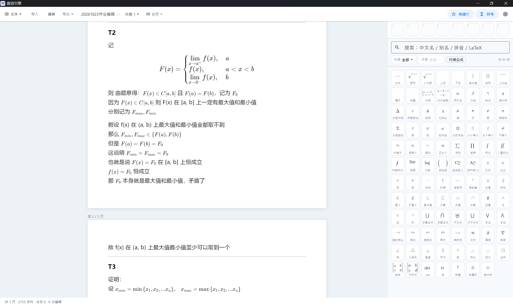
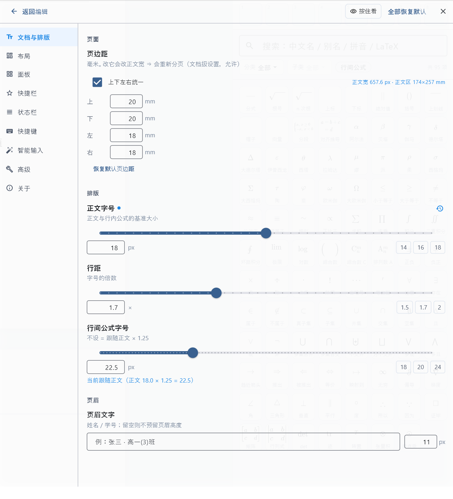

# 数语引擎 · MathLang

> **可视化数学文档编辑器。**
> 支持导入 `txt` / `md` 文档、渲染数学语言，通过**符号面板点选**与**快捷键**实现可视化编辑，
> 并支持导出为 `txt` / `md` / `PDF` / 图片集。
> 数学公式就在正文里**直接看得见、点得到、改得了**——不用学 LaTeX，编码永不露出。
> 底层是标准 Markdown + 标准 LaTeX：纯文本、可版本管理、AI 能直接读写。

Windows 10/11 64 位 · Flutter 桌面应用 · MIT

## 能做什么

- **导入即用**：`txt` / `md` 直接导入；规范 md **一字不改**，AI 答案里常见的裸 LaTeX 会自动包成公式（可在「诊断清单」里逐条查看与跳转）。
- **可视化编辑**：右侧符号面板**四路搜索**（中文名 / 别名 / 拼音 / LaTeX）+ 模板插入 + 占位符跳转；常用结构还有「快捷栏」一格一符号，配 `F6`/`F7` 全键盘操作。
- **导出四件套**：`txt` / `md` / **PDF**（图片式，内嵌 md 附件）/ **图片集**（每页一张 PNG）。
- **排版随便调**：可以在设置里调整界面 UI、编辑器界面位置、字体大小等参数，改完**按 A4 重新分页**。
- **所见即所得的分页**：编辑时的分页 = 导出的 PDF 页 = 图片集的一张图。

## 截图

|  |  |
|---|---|
| 编辑界面 | 设置界面 |

## 下载与安装（Windows 10/11 64 位）

到 [Releases](https://github.com/block255/mathlang/releases/latest) 下载。三个包任选一个：

| 包 | 适合谁 | 怎么用 |
|---|---|---|
| `mathlang-v1.1.0-win64-setup.zip` ★推荐 | 想装好、以后**不弹** SmartScreen | 解压 → 双击 `数语引擎\双击我安装数语引擎.cmd` |
| `mathlang-v1.1.0-win64-portable.zip` | 想要绿色版（解压即用、不写系统目录） | 解压 → **先双击 `启动数语引擎.cmd`**（装一次证书） |
| `mathlang-v1.1.0-x64.msix` | 只想装 MSIX | 先信任包里的 `.cer`，再双击 `.msix` |

安装那一步会弹**一次**管理员授权（把本软件的自签证书放进「受信任的根」）→ 点「是」⇒ 自动安装并打开。
★ 之后从桌面 / 开始菜单打开，**都不会再弹 SmartScreen**。
★ 现在用的是自签证书，所以那一次 UAC 省不掉；将来换成公共 CA 签名（开源项目可申请 SignPath）就不需要了。

## 它解决什么

| 市面上的现状 | 这里的做法 |
|---|---|
| 写数学要学 LaTeX 语法 | **可视化编辑**：符号面板 + 模板插入 + 占位符跳转，数学编码永不出现 |
| 公式是"卡片"，要进去要出来 | **平权**：一条字符流里文字与数学地位相同，光标、选择、删除都是同一套语义 |
| 导出只能给截图 | **A4 分页**：编辑时的分页 = 导出的 PDF 页 = 图片集的一张图 |
| 换行对齐靠手数 | 多行推导用 `aligned` 模板按等号对齐 |
| 符号面板缺失 / 快捷键不能改 | 分类面板 + 四路搜索 + **48 条可改键快捷键** |

## 三条最要紧的设计约定

1. **平权**（最高原则）：一条可见流里，汉字、字母、`≥`、分式、整段公式都是**同一层对象**——
   没有模式、没有"进入/退出"、没有特权区域。数学不是"另一种东西"，只是字符被渲染成了二维。
2. **文档格式 = Markdown + 标准 LaTeX**：唯一事实来源是纯文本，AI 能直接读写。
3. **静默失败必须可见**：渲染不了的命令、溢出一页的块、解析失败的行，都有提示或「诊断清单」。

## 从源码构建

需要 Flutter **3.47.1**（stable）。

```powershell
cd app
flutter pub get
flutter analyze
flutter test
flutter build windows --release
```

打包（Windows）：

```powershell
powershell -ExecutionPolicy Bypass -File scripts\build_exe.ps1     # analyze + test + build + 自签 + 归档到 dist\v<版本>\
powershell -ExecutionPolicy Bypass -File scripts\pack_release.ps1  # 绿色版 zip
powershell -ExecutionPolicy Bypass -File scripts\pack_msix.ps1     # MSIX + 一键安装 zip
```

## 键盘

- **写作**：`Enter` 新段落 · `Shift+Enter` 段内换行 · `Ctrl+Z/Shift+Z` 撤销重做 ·
  `Ctrl+1/2/3` 标题 · `Ctrl+Alt+F/R/I/S/L/A/T/X/B` 九种模板 · `Ctrl+Enter` 分页符
- **面板键盘流**：`F6` 进符号面板（方向键移动 / `Enter` 或空格插入 / `1–8` 跳格 / `Tab` 去搜索）·
  `F7` 进快捷栏（`Enter` 赋值 / `Delete` 清空）· `Esc` 回编辑器
- 全部 48 条快捷键在「设置 → 快捷键」里**可改键、可停用**。

## 目录结构

- `app/` —— Flutter 工程（`lib/` 源码 · `test/` 测试）
- `docs/images/` —— README 配图
- `notes/` —— 设计文档 / 交接快照 / 开发日志（这个项目最贵的资产）
- `scripts/` —— 构建、打包、签名、热重载脚本
- `signing/` —— 签名材料（密钥不入库）
- `test_data/` —— 测试数据（含个人作业样本，不入库）
- `dist/` —— 发布产物（不入库）

设计文档在 [`notes/design/`](notes/design/)，逐批开发记录在 [`notes/handover/`](notes/handover/)，
踩坑经验在 [`notes/dev_log/`](notes/dev_log/)，待办与已收口清单在 [`notes/后优化清单.md`](notes/后优化清单.md)。

## 状态

版本 **1.1.0**，Windows 已可用；移动端在路线图里。

## English

**MathLang (数语引擎)** — a visual math-document editor for Windows 10/11 (64-bit), built with Flutter.

- Import `txt` / `md`; math is **rendered**, never shown as LaTeX source.
- Edit visually: symbol panel with four-way search (Chinese name / alias / pinyin / LaTeX), insertable templates, 48 rebindable shortcuts, and a quick-bar of favourite symbols.
- Export to `txt` / `md` / **PDF** (image-based, with the `.md` embedded) / **PNG page set**.
- Everything is stored as plain **Markdown + standard LaTeX**, so any editor or AI can read and write your documents.
- Settings cover the UI layout, the editor position and font sizes, with live A4 repagination.

Download the latest `mathlang-vX.Y.Z-win64-setup.zip` from [Releases](https://github.com/block255/mathlang/releases/latest),
unzip, then run `数语引擎\双击我安装数语引擎.cmd` (one-time admin prompt to trust the self-signed certificate).

Status: v1.1.0. Mobile is on the roadmap.

## 许可

[MIT](LICENSE) © 2026 yizhinaimao (block255)

---

> 本项目的开发由 **DeepSeek** 在 **DSH** 上完成。
